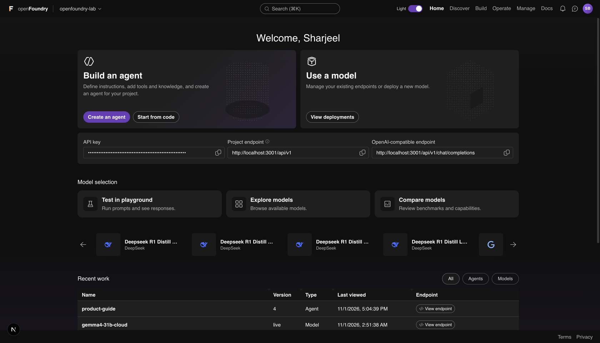
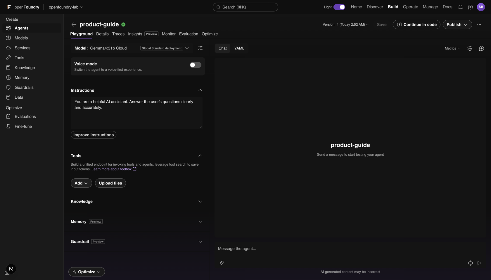
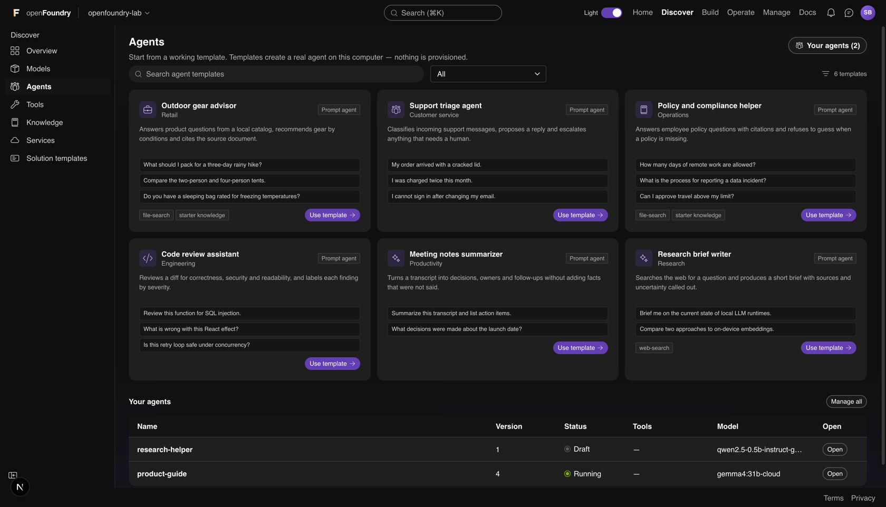
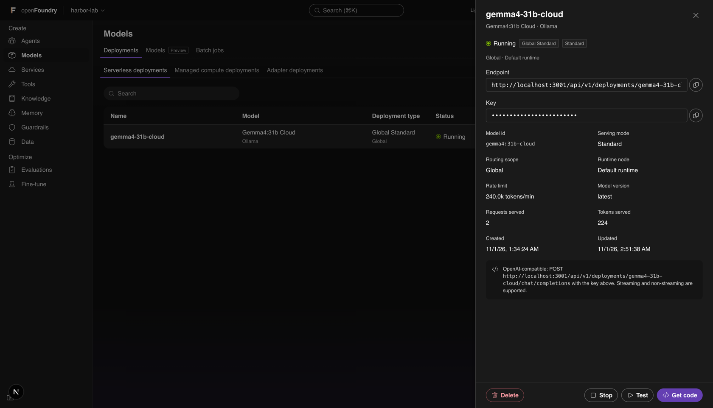
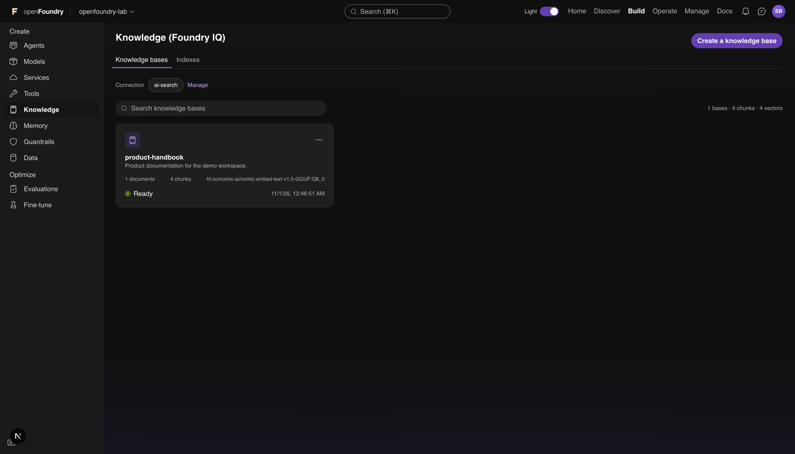
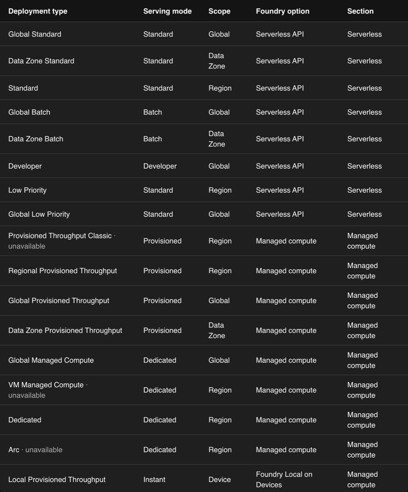

# openFoundry

**A local AI workbench for your own computer.**

[Website](https://openfoundry.pages.dev) | [Documentation](https://openfoundry.pages.dev/docs/) | [Download for macOS](https://github.com/Sharjeelbaig/openFoundry/releases/download/v0.4.5-macos-beta.1/openFoundry_0.4.5_aarch64.dmg) | [Download for Windows](https://github.com/Sharjeelbaig/openFoundry/releases/download/v0.4.5-windows-beta.1/openFoundry_0.4.5_x64-setup.exe) | [Download for Linux](https://github.com/Sharjeelbaig/openFoundry/releases/download/v0.4.5-linux-beta.1/openFoundry_0.4.5_amd64.deb) | [GitHub](https://github.com/Sharjeelbaig/openFoundry)

openFoundry is a free, independent desktop app for discovering models, chatting with
them, and building prompt agents. Workspace data stays on your machine and the app talks
directly to the model runtimes you configure.

> openFoundry is an independent project. It is not affiliated with, endorsed by, or
> sponsored by any model provider or platform vendor, and it does not use their brand
> assets as its own identity.

## Status

openFoundry 0.4.3 is available as a beta desktop app for macOS (Apple silicon) and
Windows (x64), and as a web workspace. Both run the same Next.js app, keep workspace data
on the machine, and talk directly to the model runtimes you configure. The desktop build
is packaged with Tauri 2.

Neither desktop build is code signed yet. macOS asks for confirmation on first launch
(right-click, Open), and Windows SmartScreen asks for confirmation (More info, Run
anyway).

What it does:

- First-run setup before the workspace: independence terms, profile, provider endpoints,
  and a first model.
- Provider discovery for Foundry Local, Ollama, LM Studio, llama.cpp server, and the local
  Hugging Face cache.
- Downloadable model discovery from the Hugging Face catalog and the Foundry Local CLI
  catalog.
- Background model downloads through the configured local runtime, with an expandable
  download center, percentage progress, byte counts, logs, cancel, and dismiss.
- A guided return to provider setup when a model needs a runtime that is not running.
- Guardrails with deterministic PII and credential checks, an optional local-model
  semantic layer, and human approval for destructive tool calls.
- Knowledge connectors for local SharePoint/OneDrive exports and Fabric CSV/JSON
  exports, alongside files, folders, web, git, SQLite, S3, Azure Blob and WebDAV.
- The complete openFoundry workspace: home, discover, build, operate, manage, playground,
  model detail pages, filters, deployments, agents, knowledge, services, tools and docs.
- Workspace settings, local API key, provider URLs, terms and privacy pages.
- Local access control: a directory of people, access codes, sessions, and
  Owner / Contributor / Foundry User / Reader roles enforced on every request. Role assignment
  follows the Azure IAM flow Foundry uses: `Role → Members → Review + assign`.
- Desktop packaging: the Tauri bundle starts a bundled Next.js standalone server and Node
  runtime on a free loopback port, and stores workspace data in the OS app-data directory.
- One-click llama.cpp: the setup wizard downloads the matching llama.cpp server build and
  a Qwen2.5 0.5B starter model, then starts `llama-server` on a managed port. Ollama, LM
  Studio and Foundry Local keep their own installers and are reported honestly.
- An `openFoundry` command line in both desktop builds for access-code recovery and status.

## Roadmap

- Windows installer testing on real Windows hardware (the bundle is built and staged, but
  has not been run on a Windows machine yet).
- Automatic installation for the remaining runtimes (Ollama, LM Studio, Foundry Local).

## Screenshots

### Home



The home screen is the starting point for a project. It shows the project endpoint and
API key, shortcuts into the playground and the model catalog, and the agents and
deployments you used most recently. Each recent item links to its endpoint.

### Agent builder and playground



The agent builder defines an agent and tests it on one screen. The left column holds the
model, voice mode, instructions, tools, knowledge bases, memory and guardrail. The right
column is the playground: use the Chat tab to talk to the agent, or the YAML tab to
inspect the configuration. Save writes a new version. Publish marks the agent as running
and keeps the earlier versions in the history list.

### Agent discovery



Discover > Agents lists templates for common jobs, including outdoor gear advice,
support triage, policy questions, code review, meeting notes and research. Search filters
by name and the category menu narrows the list further. Each template has example prompts
and shows which tools it uses. "Use template" creates a real agent on this computer. The
lower half lists the agents you already have, with version, status, tools, model and an
Open button.

### Agent deployment



Opening a deployment shows its model card. The card contains the live endpoint and key,
the model identifier, the serving mode, the routing scope, the rate limit, and the number
of requests and tokens the deployment has served. From here you can test the deployment,
copy a working code sample, stop it or delete it.

### Foundry IQ knowledge



Foundry IQ is the knowledge layer. A knowledge base stores uploaded documents, splits
them into chunks and builds a local vector index with an embedding model. Agents can
attach one or more bases and cite the source chunks in their answers. The card shows the
document and chunk counts, the embedding model and the index status.

### Deployment types



Foundry puts three separate ideas into one deployment type label. openFoundry keeps them
apart, so the parts that can work on a single computer really work:

- **Serving mode** is how a request is served. Standard and Developer meter tokens per
  minute and return `429` when the limit is reached. Provisioned reserves concurrency
  slots and queues extra requests. Batch accepts asynchronous jobs only. Instant answers
  immediately from the local runtime, with no queue.
- **Scope** is where a request is routed. Global can use any online runtime node, Data
  Zone uses nodes tagged for a zone, Region pins one node, and Device is this computer.
  Routing is real. The data residency guarantee is the only part that stays simulated,
  because there is no cloud region.
- **Section** is the Build > Models tab that lists the deployment: Serverless, Managed
  compute or Adapter.

Billing is always $0 on this computer. Token counts are real. Any cloud equivalent cost
is shown as an estimate, never as a bill.

| Deployment type | Serving mode | Scope | What it does here |
| --- | --- | --- | --- |
| Global Standard | Standard | Global | Metered by tokens. Routes to any online runtime node. |
| Data Zone Standard | Standard | Data Zone | Metered by tokens. Routes only to nodes tagged for a data zone. |
| Standard | Standard | Region | Metered by tokens. Pinned to one region and one node. |
| Global Batch | Batch | Global | Accepts asynchronous jobs only. No interactive chat. |
| Data Zone Batch | Batch | Data Zone | Asynchronous jobs routed to nodes in one data zone. |
| Developer | Developer | Global | Reserved for evaluation, with a lower rate limit. |
| Low Priority | Standard | Region | Metered capacity in one region that can be preempted. |
| Global Low Priority | Standard | Global | Metered capacity across nodes that can be preempted. |
| Provisioned Throughput Classic | Provisioned | Region | Not available. Legacy label; use Regional or Global Provisioned Throughput. |
| Regional Provisioned Throughput | Provisioned | Region | Reserves concurrency slots in one region. Extra requests queue. |
| Global Provisioned Throughput | Provisioned | Global | Reserves concurrency slots across any online node. |
| Data Zone Provisioned Throughput | Provisioned | Data Zone | Reserves concurrency slots on nodes in one data zone. |
| Global Managed Compute | Dedicated | Global | Keeps a dedicated model instance resident for one workload. |
| VM Managed Compute | Dedicated | Region | Not available. Needs an Azure VM; register a runtime node to approximate it. |
| Dedicated | Dedicated | Region | Keeps dedicated capacity resident in one region. |
| Arc | Dedicated | Region | Not available. Needs an Azure Arc machine; register a runtime node to approximate it. |
| Local Provisioned Throughput | Instant | Device | Runs on this computer and stays ready. This is the default. |

## Run the web workspace

Requirements: Node.js 20.9+.

```bash
npm install
npm run dev
```

The dev server uses port 3000 by default. `npm run dev:web` forces port 3001.

On first run the server prints a one-time setup token and sends the browser to `/setup`. Enter it
there to claim the install and receive your access code. After that, sign in at `/signin` with the
code. If you lose it:

```bash
npm run access-code
```

For the installed desktop app, point it at the app data directory:

```bash
npm run access-code -- --desktop
```

Both desktop builds also ship a standalone `openFoundry` command that reads the same
`directory.json`. On macOS it is linked into `/usr/local/bin` or `~/.local/bin` on first
launch; the Windows installer puts it on the machine `PATH`. Open a new terminal after
installing.

```bash
openFoundry access-code            # mint a code, replacing the old one
openFoundry access-code list       # every code and its state
openFoundry access-code revoke     # revoke codes and sign out sessions
openFoundry status                 # data directory, owners, sessions
```

The dev server is not a desktop build, so it uses the token, not the machine credential.

## Run the desktop app

Requirements: Node.js, Rust stable, and the Tauri system prerequisites for your OS.

```bash
npm install
npm run desktop:dev
```

`tauri dev` starts Next on port 1420 and opens the desktop window.

## Build a desktop installer

```bash
npm run desktop:build
```

The build hook runs `next build`, precompiles the standalone server, downloads the pinned
Node LTS runtime for the target platform, then bundles the Tauri app. Release bundles are
written under `src-tauri/target/release/bundle/`.

A full build leaves several gigabytes in `.next`, `src-tauri/target` and the sidecar
folders. After copying the DMG, run:

```bash
npm run clean
```

It removes those build outputs only. The installed app and your workspace data are not
touched.

The macOS arm64 build is approximately 190 MB installed, 56 MB as a DMG. The Windows x64
build is about 36 MB as a setup executable and 54 MB as a portable ZIP. Most of that is
the embedded Node runtime. Removing it would require replacing the Next.js server with a
native or static implementation; the current tradeoff keeps the workspace identical to
the web build and works without requiring Node on the user's computer.

To produce the Windows bundle from macOS, install `mingw-w64` and `makensis`, add the
`x86_64-pc-windows-gnu` Rust target, and run `npm run desktop:build` with the target set.
The build hook downloads the Windows Node runtime and stages the server, the CLI wrapper
and `WebView2Loader.dll`.

The Linux `.deb` is about 64 MB. It builds on Ubuntu 22.04+ or Debian 12+ with
`npm run desktop:build -- --target x86_64-unknown-linux-gnu --bundles deb`, or from the
manual `Release Linux` workflow on GitHub Actions. The package declares
`libwebkit2gtk-4.1-0` and `libgtk-3-0`, and installs with
`sudo apt install ./openFoundry_<version>_amd64.deb`.

## Providers

| Provider | Default endpoint |
| --- | --- |
| Foundry Local | `http://127.0.0.1:50414` |
| Ollama | `http://127.0.0.1:11434` |
| LM Studio | `http://127.0.0.1:1234` |
| llama.cpp server | `http://127.0.0.1:8080` |
| Hugging Face | local cache (`~/.cache/huggingface/hub` by default) |

The app scans the endpoints and shows what they report. Model metadata is not invented.
Hugging Face downloads use `ollama pull hf.co/<repo>`; Foundry Local downloads use the
Foundry CLI. Model weights and licenses belong to their publishers; openFoundry does not
redistribute them.

## Architecture

- **Next.js 16 + React 19 + TypeScript**: workspace UI and local API routes.
- **Tauri 2 + Rust**: desktop shell, free-port selection, sidecar lifecycle.
- **Bundled Node.js + Next standalone server**: production desktop runtime. On macOS the
  runtime is wrapped in a hidden `LSUIElement` helper app so it never appears as a second
  Dock icon or foreground application.
- JSON workspace store under the OS app-data directory in desktop builds, or `data/` in
  the web build.
- Direct provider APIs; no openFoundry cloud service and no telemetry.
- Light and dark themes from one token set; the header switch stores the choice in a
  cookie so the server renders the right palette on the first paint.

## Repository layout

```
src/app/                 Next.js pages and API routes
src/components/          Workspace UI, setup wizard, download center
src/lib/                 Providers, store, model discovery, downloads
src-tauri/               Tauri shell, loading screen, icons
scripts/                 Desktop resource preparation
public/brand/            openFoundry mark and app tile sources
public/                  Other openFoundry artwork
BRAND.md                 Mark, colour and usage rules
```

## Support

- Documentation: https://openfoundry.pages.dev/docs/
- Issues: https://github.com/Sharjeelbaig/openFoundry/issues
- Email: eng.sharjeel.baig@gmail.com

## Credit

openFoundry is created and maintained by Sharjeel Baig.

If you use openFoundry, or a substantial part of it, credit it as:

> openFoundry by Sharjeel Baig, https://github.com/Sharjeelbaig/openFoundry

The Apache-2.0 license requires you to keep the copyright notice, the [LICENSE](LICENSE)
file and the [NOTICE](NOTICE) file, and to state what you changed. The openFoundry name
and logo are not covered by the license; see [TRADEMARKS.md](TRADEMARKS.md).

## License

Apache-2.0. See [LICENSE](LICENSE). Third-party notices are in [NOTICE.md](NOTICE.md).
