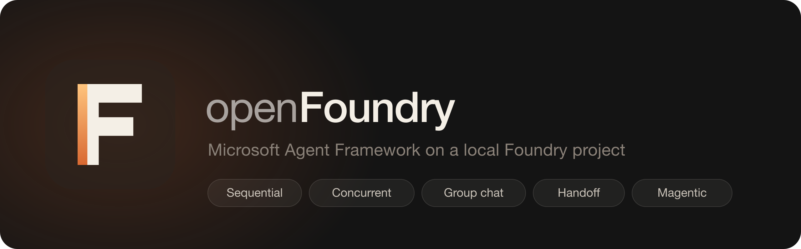

<p align="center">
  
</p>

<h1 align="center">openfoundry-agent-framework</h1>

<p align="center">
  <strong>Run the official Microsoft Agent Framework SDK against a local openFoundry project.</strong><br>
  No Azure subscription. No Entra tenant. No <code>az login</code>.
</p>

<p align="center">
  <a href="https://pypi.org/project/openfoundry-agent-framework/"></a>
  <a href="https://pypi.org/project/openfoundry-agent-framework/"></a>
  <a href="https://github.com/Sharjeelbaig/openFoundry/blob/main/LICENSE"></a>
  <a href="https://pypi.org/project/agent-framework/"></a>
  <a href="https://openfoundry.pages.dev"></a>
</p>

<p align="center">
  
</p>

---

The official `agent-framework` SDK talks to a Foundry project through `FoundryChatClient`
and `AIProjectClient`. Both expect a project endpoint and a `TokenCredential`.

openFoundry serves those same project paths on loopback
(`/api/projects/<project>/openai/v1`) and authenticates with a **project API key** that is
generated and stored on your own machine. This package supplies the one missing piece — a
`TokenCredential` that presents that key as a bearer token — plus small factories so the
common cases are one line.

```python
from openfoundry_agent_framework import create_agent

agent = create_agent(name="LocalAgent", instructions="Answer in one short sentence.")
result = await agent.run("What is the Agent Framework SDK?")
print(result.text)
```

Everything above `Agent` is unmodified Microsoft SDK: `SequentialBuilder`,
`ConcurrentBuilder`, `GroupChatBuilder`, `HandoffBuilder`, `MagenticBuilder`, function
tools, streaming, `FoundryAgent` against a project agent version, and the Responses API.

---

## Contents

- [Install](#install)
- [Quickstart](#quickstart)
- [Configuration](#configuration)
- [API at a glance](#api-at-a-glance)
- [Multi-agent orchestration](#multi-agent-orchestration)
- [Project agents (agent versions)](#project-agents-agent-versions)
- [Using the official SDK directly](#using-the-official-sdk-directly)
- [Compatibility](#compatibility)
- [Limits](#limits)
- [Documentation](#documentation)
- [Development](#development)
- [License](#license)

---

## Install

```bash
pip install openfoundry-agent-framework
```

Requires **Python 3.11+**. Python **3.13** is the tested interpreter; some transitive
dependencies do not yet publish wheels for 3.14+.

You also need the openFoundry app running locally with at least one model available
([download](https://openfoundry.pages.dev) or run the web workspace from the repo).

## Quickstart

**1. Start openFoundry and pick a model.** The web workspace listens on
`http://127.0.0.1:3000` (`npm run dev:web` forces `3001`); the desktop app picks a free
loopback port and shows it.

**2. Copy your endpoint and key** from **Manage → Project details**. The endpoint has the
shape:

```text
http://127.0.0.1:3000/api/projects/openfoundry-lab
```

**3. Export three variables.**

```bash
export OPENFOUNDRY_PROJECT_ENDPOINT="http://127.0.0.1:3000/api/projects/openfoundry-lab"
export OPENFOUNDRY_API_KEY="<project api key>"
export OPENFOUNDRY_MODEL="<deployment or model id shown in openFoundry>"
```

**4. Run an agent.**

```python
import asyncio
from openfoundry_agent_framework import create_agent


async def main() -> None:
    agent = create_agent(
        name="LocalAgent",
        instructions="You are a concise assistant. Answer in one short sentence.",
    )
    result = await agent.run("What is the Microsoft Agent Framework?")
    print(result.text)


if __name__ == "__main__":
    asyncio.run(main())
```

`create_agent` raises `ValueError` with a specific message if `OPENFOUNDRY_API_KEY` or
`OPENFOUNDRY_MODEL` is unset, so a missing variable fails at construction rather than
halfway through a workflow.

## Configuration

| Variable | Required | Default | Purpose |
| --- | --- | --- | --- |
| `OPENFOUNDRY_API_KEY` | yes | — | Project API key from **Manage → Project details**. Sent as the bearer token. |
| `OPENFOUNDRY_MODEL` | yes | — | Deployment name or model id that openFoundry resolves to your local runtime. |
| `OPENFOUNDRY_PROJECT_ENDPOINT` | no | `http://127.0.0.1:3000/api/projects/openfoundry-lab` | Project endpoint. Trailing slashes are trimmed. |

Precedence is **explicit argument → environment → default**. Every factory accepts the
values directly, so you can drive several projects or models from one process:

```python
from openfoundry_agent_framework import create_chat_client

fast = create_chat_client(model="qwen3:4b", api_key=fast_key)
deep = create_chat_client(model="gemma4:31b-cloud", api_key=deep_key)
```

The project key never leaves your machine: `OpenFoundryCredential` returns it as an
`AccessToken` and the SDK only sends it to the endpoint you configured.

## API at a glance

| Symbol | Returns | Use |
| --- | --- | --- |
| `create_agent(...)` | `agent_framework.Agent` | One agent over the local project. Most common entry point. |
| `create_chat_client(...)` | `FoundryChatClient` | Build `Agent` objects yourself, or pass the client around. |
| `create_project_client(...)` | `azure.ai.projects.AIProjectClient` | Manage project agent versions, conversations, Responses. |
| `create_foundry_agent(...)` | `FoundryAgent` | Run a prompt agent version created on the project. |
| `OpenFoundryCredential(...)` | `TokenCredential` | Drop-in replacement for `AzureCliCredential`. |
| `DEFAULT_PROJECT_ENDPOINT` | `str` | The loopback default above. |

### `create_agent`

```python
create_agent(
    *,
    name: str,
    instructions: str,
    model: str | None = None,
    project_endpoint: str | None = None,
    api_key: str | None = None,
    **agent_options,
) -> Agent
```

All keyword-only. Extra keyword arguments are forwarded to `Agent` — for example
`require_per_service_call_history_persistence=True`, which the SDK requires for handoff
orchestration.

### `create_chat_client`

```python
create_chat_client(
    *,
    model: str | None = None,
    project_endpoint: str | None = None,
    api_key: str | None = None,
) -> FoundryChatClient
```

The official `FoundryChatClient`, pointed at openFoundry with an
`OpenFoundryCredential`. Use `chat_client.as_agent(name=..., instructions=...)` for
agents that share one client.

### `create_project_client`

```python
create_project_client(
    *,
    project_endpoint: str | None = None,
    api_key: str | None = None,
) -> AIProjectClient
```

For the operations that only exist on the project surface — agent versions,
conversations, stored Responses. Remember `enforce_https=False` on mutating calls: Azure
Core refuses bearer auth over plain HTTP by default, and a loopback lab endpoint is HTTP.

### `create_foundry_agent`

```python
create_foundry_agent(
    *,
    agent_name: str,
    agent_version: str | None = None,
    project_endpoint: str | None = None,
    api_key: str | None = None,
    **kwargs,
) -> FoundryAgent
```

Connects to a prompt agent version that already exists on the project. Pass
`agent_version` to pin one; omit it to use the latest.

### `OpenFoundryCredential`

```python
OpenFoundryCredential(api_key: str | None = None)
```

Reads `OPENFOUNDRY_API_KEY` when `api_key` is omitted. Implements `get_token`,
`get_token_async` and `close`, returning the key with a one-hour expiry (the SDK
refreshes it; the key never rotates).

## Multi-agent orchestration

```python
import asyncio
from agent_framework import Message
from agent_framework.orchestrations import SequentialBuilder
from openfoundry_agent_framework import create_agent


async def main() -> None:
    summarizer = create_agent(
        name="summarizer",
        instructions="Condense the feedback into one short, neutral sentence.",
    )
    classifier = create_agent(
        name="classifier",
        instructions="Reply with exactly one of: Positive, Negative, Feature request.",
    )
    action = create_agent(
        name="action",
        instructions="Recommend one concrete follow-up step in one sentence.",
    )

    workflow = SequentialBuilder(
        participants=[summarizer, classifier, action],
        output_from="all",
    ).build()

    result = await workflow.run("Customer feedback: the dark theme is missing.")
    for response in result.get_outputs():
        for msg in response.messages:
            print(f"[{msg.author_name or msg.role}] {msg.text}")


asyncio.run(main())
```

The other builders work the same way — `ConcurrentBuilder`, `GroupChatBuilder`,
`HandoffBuilder`, `MagenticBuilder`. Full examples, including the quirks of each pattern,
are in [`docs/orchestrations.md`](https://github.com/Sharjeelbaig/openFoundry/blob/main/sdk/python/docs/orchestrations.md)
and runnable code lives in
[`examples/orchestrations.py`](https://github.com/Sharjeelbaig/openFoundry/blob/main/sdk/python/examples/orchestrations.py).

Close the clients your agents own when a workflow finishes, otherwise long test runs
leave connections open:

```python
try:
    ...
finally:
    await summarizer.client.close()
```

## Project agents (agent versions)

Prompt agents defined on the project, then run through `FoundryAgent`:

```python
from azure.ai.projects.models import PromptAgentDefinition
from openfoundry_agent_framework import create_foundry_agent, create_project_client

project = create_project_client()
project.agents.create_version(
    agent_name="local-agent",
    definition=PromptAgentDefinition(
        model="gemma4:31b-cloud",
        instructions="Answer in one short sentence.",
    ),
    enforce_https=False,
)

agent = create_foundry_agent(agent_name="local-agent")
print((await agent.run("Hello from the project agent.")).text)
```

`enforce_https=False` is the Azure SDK's per-operation opt-out for a loopback HTTP
endpoint. openFoundry's `/api/projects/<project>/agents/<name>/versions` routes
authenticate with the project key, so no Entra tenant is involved.

## Using the official SDK directly

If you would rather not use the helpers — or you are following a Microsoft lab — the diff
is one import and one line:

```python
# Before (Microsoft Foundry, Azure CLI)
from azure.identity import AzureCliCredential
credential = AzureCliCredential()

# After (openFoundry, project key)
from openfoundry_agent_framework import OpenFoundryCredential
credential = OpenFoundryCredential()

chat_client = FoundryChatClient(
    credential=credential,
    project_endpoint=os.getenv("OPENFOUNDRY_PROJECT_ENDPOINT"),
    model=os.getenv("OPENFOUNDRY_MODEL"),
)
```

Agent instructions, `as_agent(...)`, `SequentialBuilder`, `output_from="all"`,
`workflow.run(...)` and `result.get_outputs()` are unchanged. Any lab that uses
`AzureCliCredential` with `FoundryChatClient` is a credential swap away.

## Compatibility

| Surface | Status |
| --- | --- |
| `FoundryChatClient` + `Agent` | Runs against the local project |
| `Sequential`, `Concurrent`, `GroupChat`, `Handoff`, `Magentic` builders | Run against the local project |
| Streaming, including function-call streaming | Supported |
| Function tools and Responses API | Supported |
| Project agent versions + `FoundryAgent` | Supported |
| Conversations and stored responses | Supported |
| Voice Live transport (preview) | Supported by openFoundry; SDK coverage varies |

Built against `agent-framework>=1.24.0` and `azure-ai-projects>=2.0.0`. The repository's
live suite (`tests/test_live.py`, 13 tests) exercises these surfaces end to end against a
running server.

What changes between Foundry and openFoundry:

| | Microsoft Foundry | openFoundry |
| --- | --- | --- |
| Credential | `AzureCliCredential` / Entra | `OpenFoundryCredential` (project key) |
| Endpoint | Foundry project endpoint | `http://127.0.0.1:<port>/api/projects/<project>` |
| Model | Hosted deployment (`gpt-5`, …) | A model your local runtime serves |
| Setup | Subscription, resource group, `az login` | App installed, project created |
| HTTPS | Enforced | Loopback HTTP, `enforce_https=False` for project operations |

## Limits

Honest scope, so nothing surprises you in a lab:

- **Local models only.** You get the model quality, latency and context window of the
  runtime you configured, not `gpt-5`.
- **Loopback HTTP.** Plain-HTTP bearer auth is refused by Azure Core unless the operation
  opts out with `enforce_https=False`. That is a lab setting; do not expose the endpoint.
- **The key is a bearer token.** Anyone who can read it can call your project. It is not
  an Entra identity and carries no tenant, RBAC or Conditional Access.
- **No Microsoft-hosted capabilities.** Work IQ, SharePoint/Fabric tenant access,
  Content Understanding, Azure AI Search and Azure Content Safety have no local
  equivalent.
- **Not affiliated with Microsoft.** openFoundry is an independent project; this package
  is not endorsed by or sponsored by Microsoft.

## Documentation

| Document | Contents |
| --- | --- |
| [Configuration](https://github.com/Sharjeelbaig/openFoundry/blob/main/sdk/python/docs/configuration.md) | Endpoints, ports, precedence, multiple projects |
| [API reference](https://github.com/Sharjeelbaig/openFoundry/blob/main/sdk/python/docs/api.md) | Every export, parameter, return value and error |
| [Orchestrations](https://github.com/Sharjeelbaig/openFoundry/blob/main/sdk/python/docs/orchestrations.md) | Sequential, concurrent, group chat, handoff, Magentic |
| [Agent versions](https://github.com/Sharjeelbaig/openFoundry/blob/main/sdk/python/docs/agent-versions.md) | Prompt agents, versions, conversations |
| [Troubleshooting](https://github.com/Sharjeelbaig/openFoundry/blob/main/sdk/python/docs/troubleshooting.md) | Connection, auth, model and streaming failures |
| [Compatibility](https://github.com/Sharjeelbaig/openFoundry/blob/main/sdk/python/docs/compatibility.md) | What maps to Foundry, what does not |

## Development

```bash
git clone https://github.com/Sharjeelbaig/openFoundry.git
cd openFoundry/sdk/python

python3.13 -m venv .venv
.venv/bin/pip install -U pip
.venv/bin/pip install -e ".[dev]"

# Live suite — needs a running server with a model
OPENFOUNDRY_API_KEY=... OPENFOUNDRY_MODEL=... \
  PYTHONPATH=. .venv/bin/python -m unittest -v tests/test_live.py
```

Build and inspect the distribution:

```bash
.venv/bin/python -m build
.venv/bin/twine check dist/*
```

Sample scripts: [`examples/single_agent.py`](https://github.com/Sharjeelbaig/openFoundry/blob/main/sdk/python/examples/single_agent.py),
[`examples/orchestrations.py`](https://github.com/Sharjeelbaig/openFoundry/blob/main/sdk/python/examples/orchestrations.py).

## License

Apache-2.0. See [LICENSE](https://github.com/Sharjeelbaig/openFoundry/blob/main/LICENSE).

openFoundry is an independent project. It is not affiliated with, endorsed by, or
sponsored by Microsoft or any model provider.
